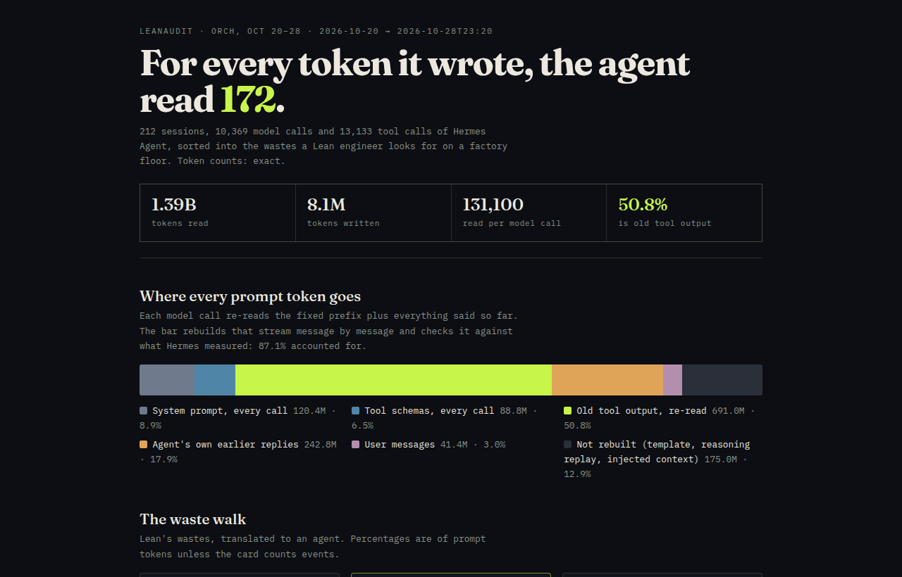

# Lean AI

**Lean manufacturing finds waste by walking the floor. `leanaudit` walks an AI agent's token stream.**

I'm a quality engineer (ISO 13485, medical devices). Since June I've run
[Hermes Agent](https://github.com/NousResearch/hermes-agent) around the clock on two DGX Sparks against a
local DeepSeek-V4.1-Flash. This repo applies the tools of my day job to that agent: name the wastes, measure each
one from the record, find the cheapest fix, and prove it on the line.



## What four months of agent traffic look like

2,621 sessions · 79,870 model calls · 96,337 tool calls, Jun 28 – Oct 28 2026, six Hermes profiles.

| | |
|---|---|
| Tokens read | **7.60 B** |
| Tokens written | **36.0 M** |
| Read per token written | **211** |
| Share of everything read that is old tool output | **49%** |

**Half of everything the agent reads is tool output it already read.** A `terminal` or `read_file` result enters
the context once and is re-read by every later call in the session. In October each tool-output token was re-read
**60 times** on average.

### The trend: what got better, and what got worse

Whole house, by month ([data](examples/)):

| | Jul | Aug | Sep | Oct |
|---|---:|---:|---:|---:|
| Tool calls that failed | 3.3% | 4.8% | 3.1% | **1.4%** |
| Repeat calls (same tool, same args) | 15.2% | 11.1% | 3.6% | **2.6%** |
| Fixed prefix (system prompt) share of reads | 19.9% | 16.3% | 16.9% | **10.9%** |
| **Old tool output share of reads** | 39.6% | 46.6% | 54.3% | **52.3%** |
| **Times each tool-output token is re-read** | 14× | 49× | 71× | **60×** |
| Scheduled runs that found nothing (+ reviews) | 1.7% | 6.4% | 7.4% | **10.4%** |

Defects and repeated motion fell 2–6× as the stack matured. The waste that grew is carried inventory: as context
windows grew to 1M tokens, sessions stopped getting compacted (on the main profile, sessions ended by compaction went
71 → 21 → 2 → 0 from July to October), so old tool output rode along for longer.

## The waste walk

Lean names eight wastes. Six of them have a clean, measurable twin in an agent loop:

| Lean waste | In an agent | How `leanaudit` measures it | orch, Oct 20–28 |
|---|---|---|---:|
| **Inventory (WIP)** | Old tool output carried in context and re-read every call | Rebuilds each session message by message; every call re-reads all history so far | **50.8%** of reads |
| **Overprocessing** | System prompt + tool schemas re-sent on every call | Exact tokens of each session's stored system prompt × its calls; today's tool schemas × calls | 15.4% |
| **Waiting** | Prompt the engine had to compute (cache miss) | Uncached ÷ all prompt tokens, only in sessions whose engine reports cache hits | 10.2% |
| **Inspection** | Scheduled checks that found nothing; after-session reviews | Cron runs whose last reply is `[SILENT]`, plus Hermes' `background_review` calls | 3.6% |
| **Defects** | Tool calls that failed; runs that died | The tool's own `success: false` / `error`; sessions ended with no output | 1.0% of calls |
| **Motion** | The same call again | Identical tool name + arguments earlier in the same session | 1.0% of calls |
| **Inventory (idle stock)** | Tool schemas shipped on every call, never used | Schema tokens × calls ÷ uses | 2 tools never used |

The other two (transport, unused talent) have no honest number yet, so they aren't scored.

**The self-check.** Rebuilding the stream from its parts (fixed prefix + every message carried forward) accounts
for **87–88%** of the prompt tokens Hermes itself measured. The rest is chat-template tokens, reasoning replay and
injected context the rebuild doesn't model. It's shown in the report as "not rebuilt", never assigned to a waste.

## Countermeasure: Hermes already ships the fix, switched off

Hermes has `compression.proactive_prune_tokens`: past a trigger size, tool results over 8,000 characters outside
the last few messages are replaced by one-line summaries. It defaults to `0` (off). Its own config comment says
why it exists: the normal compaction threshold "rarely fires on large windows, so old tool output is re-sent every
turn".

`leanaudit --whatif-prune` replays every session under those rules, including the summary size Hermes really
produces (median 44 characters on 400 real outputs) and the cache break each prune causes:

| Trigger | Reads saved | Prunes (cache breaks) | Extra recompute |
|---:|---:|---:|---:|
| 32,000 | −21.7% | 349 | 6.5 M |
| **48,000** | **−20.3%** | 272 | 6.5 M |
| 96,000 | −17.2% | 130 | 5.6 M |

orch, Oct 20–28. The recompute is small next to the 139 M tokens of cache misses that already happen.

**Live trial:** `proactive_prune_tokens: 48000` on the orch profile since **2026-10-28 23:20 CDT**. A replay can't
tell whether the agent needed the text it lost, so the trial watches two quality guards: repeat calls (Motion) and
failed tool calls.

**Second read, 2026-10-29 20:00 CDT** (20.7 h; 10 sessions, 368 model calls; before = the 3 days before the switch):

| | Before | After |
|---|---:|---:|
| Sessions where a prune committed | — | 8 of 10 |
| Tool results cut to a one-line stub | 0 | 17 (368K characters) |
| Failed tool calls | 0.51% (18 / 3,558) | 0.35% (2 / 574) |
| Repeat calls (same tool + arguments, same session) | 2.6% (94 / 3,558) | 3.3% (19 / 574) |
| Scheduled jobs, prompt tokens per call | 86.5K (3 days) · 61.6K (last 24 h) | 65.4K |
| Scheduled jobs, median session | 38.7K (3 days) · 37.0K (last 24 h) | 40.3K |

What it shows so far: the prune fires the way the code says it should, and neither quality guard has moved
outside noise (19 repeats where the old rate predicts 15). It does **not** show a token saving yet. Prompt per call
across all traffic fell from 135K to 93K, but the before window includes 12 game-building sessions (156K per call)
that moved off this profile before the switch, so that drop is traffic mix, not the prune. Like for like,
scheduled jobs are flat, and most of them never grow past a 48K trigger. The replay finds its savings in long chat
sessions, and there have been two since the switch. The next read compares those once there are enough.

Measured read-only on the profile's `state.db`: prompt = Hermes-reported input + cache-read tokens per model call,
main agent only, sessions grouped by start time. Stubs are counted from the rewritten rows (the original size is
kept in each stub).

## Run it on your own Hermes

Python 3.10+, no dependencies. `tokenizers` is optional, for exact counts.

```bash
git clone https://github.com/Coinupbtc/lean-ai && cd lean-ai

# estimate (chars/3.5), all profiles, last 30 days
python3 leanaudit.py ~/.hermes/state.db ~/.hermes/profiles/*/state.db --since 2026-10-01 --html report.html

# exact: your model's tokenizer.json, the tool schemas your profile really sends, and the prune replay
cd ~/.hermes/hermes-agent && HERMES_HOME=~/.hermes/profiles/<profile> \
  venv/bin/python /path/to/lean-ai/hermes_schemas.py --toolsets hermes-cli > /tmp/schemas.json
python3 leanaudit.py ~/.hermes/profiles/<profile>/state.db --since 2026-10-20 \
  --tokenizer /path/to/tokenizer.json --schemas /tmp/schemas.json --whatif-prune 48000 --html report.html
```

It opens each database read-only (`mode=ro`) and writes only aggregates: no message text, prompts, chat ids or
file paths. A 900 MB database takes about a minute with the exact tokenizer.

```bash
python3 -m unittest discover -s tests   # 11 tests on a synthetic state.db with hand-worked answers
```

## Limits

- **Reasoning text isn't rebuilt.** Whether earlier reasoning is replayed depends on the chat template.
- **Tool schemas are measured today** and applied to every call in the window. Only use `--schemas` for windows
  after your last toolset change.
- **Cache misses are only judged where the engine reports cache hits.** A multi-call session with zero cache reads
  ran on an engine that doesn't report them (a working cache always hits the system prompt from the second call),
  so it's left out. In September that was 96% of tokens, so September has no cache number.
- **Lead time is wall time between stored messages**, so a model step includes queueing behind other sessions.
- **Re-reading isn't free on a local box either.** A prefix cache makes it cheap to compute, but every carried token
  still fills the window, costs attention on every token generated, and on a paid API is billed at the cache-read
  rate.

## Files

| | |
|---|---|
| `leanaudit.py` | The audit. One file, standard library. |
| `hermes_schemas.py` | Dumps the tool schemas a profile sends, using Hermes' own code. |
| `report_template.html` | The self-contained HTML report. |
| `examples/` | My real reports: whole house by month and all time, and orch for Oct 20–28. |
| `docs/METHOD.md` | Every metric, its formula and why it's built that way. |

MIT licensed.
